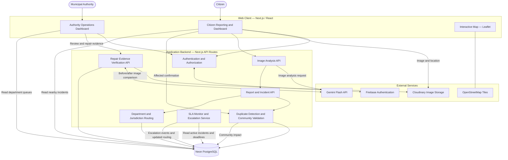
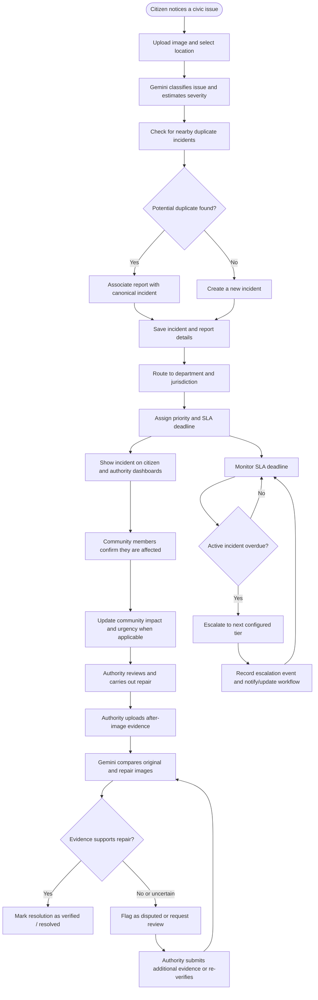
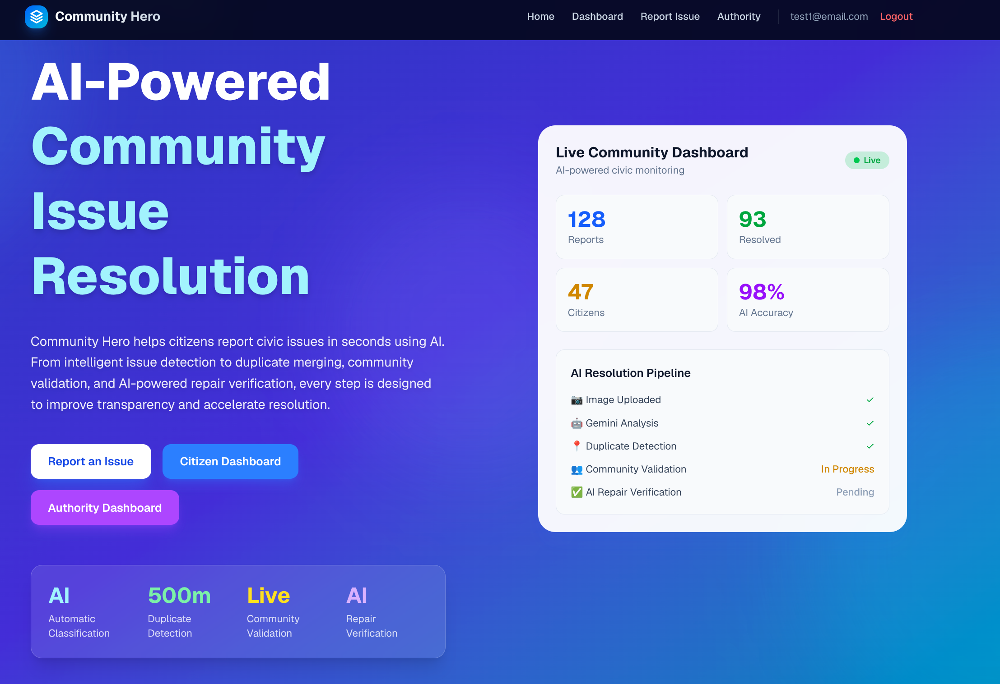
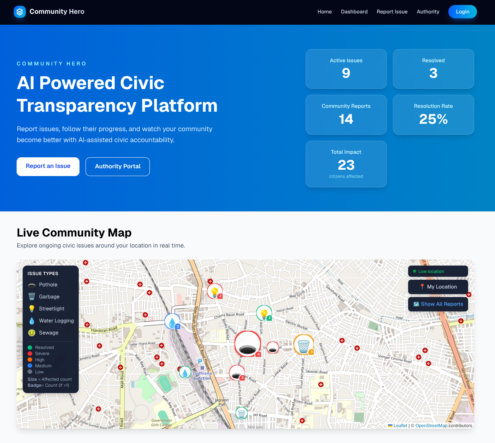
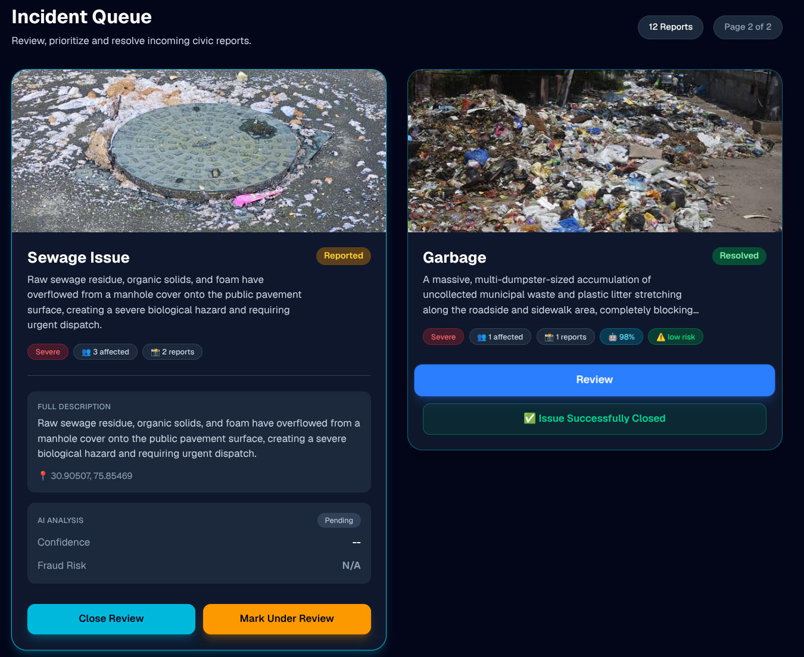
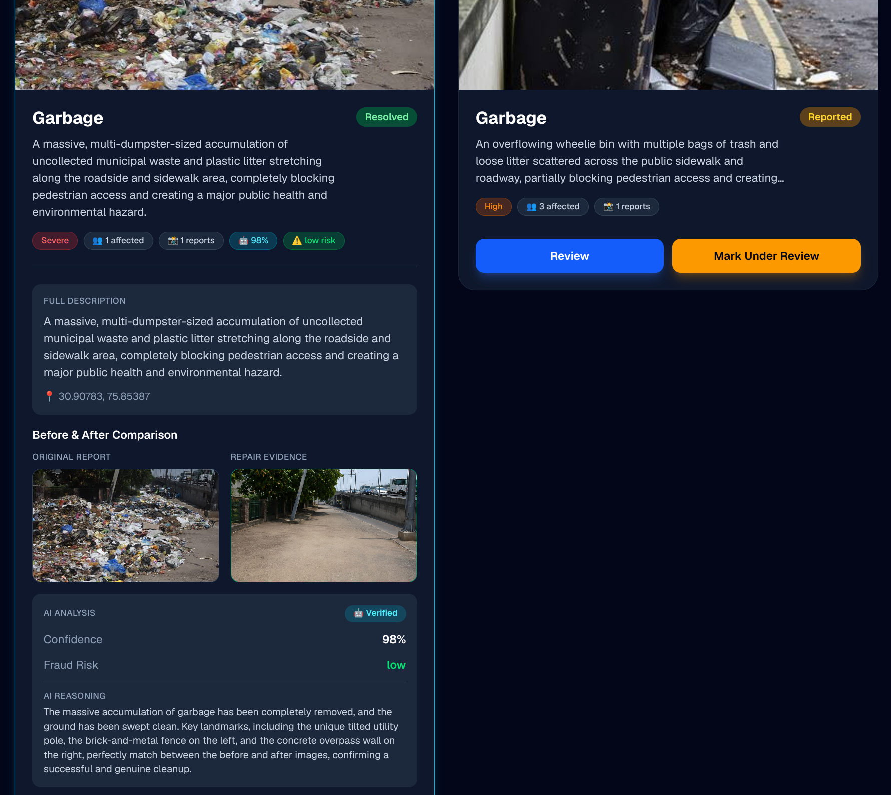
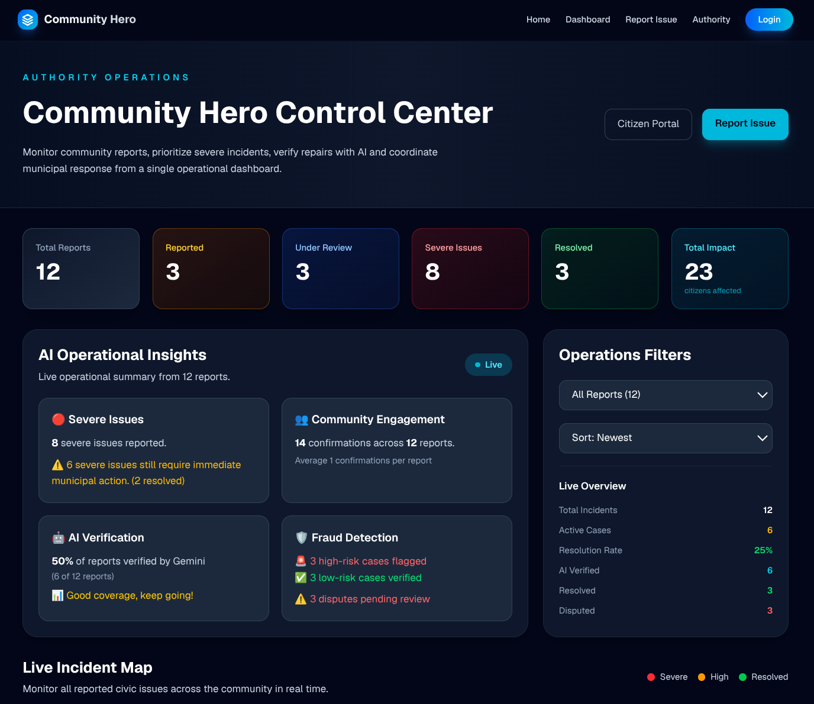

<div align="center">

# 🏙️ Community Hero

### AI-Powered Hyperlocal Civic Issue Reporting & Resolution Platform


Community Hero helps citizens report local infrastructure problems, enables communities to validate shared issues, and gives municipal authorities tools to route, prioritize, track, and verify resolutions.

[Live Demo](https://community-hero-lake.vercel.app/)

</div>

---

## 📖 Table of Contents

- [Project Overview](#-project-overview)
- [Key Features](#-key-features)
- [Tech Stack](#️-tech-stack)
- [System Architecture](#️-system-architecture)
- [End-to-End Workflow](#-end-to-end-workflow)
- [Data and Status Lifecycle](#-data-and-status-lifecycle)
- [Repository Structure](#-repository-structure)
- [Getting Started](#-getting-started)
- [Environment Variables](#-environment-variables)
- [Deployment](#-deployment)
- [Future Improvements](#-future-improvements)
- [Contributing](#-contributing)
- [Acknowledgements](#-acknowledgements)

---

## 🌍 Project Overview

### The Problem

Civic issues such as potholes, overflowing garbage, broken streetlights, waterlogging, and sewage problems can remain unresolved because reports are fragmented, responsibility is unclear, and citizens often lack visibility into what happens after they submit a complaint.

### The Community Hero Solution

**Community Hero** is an AI-assisted civic issue management platform. Citizens submit an image and location; AI helps classify the issue and estimate its severity. Reports are checked for nearby duplicates, community members can confirm that they are affected, and the platform routes incidents to the appropriate municipal department with a priority and service-level deadline.

Authorities can update the incident and submit repair evidence. AI compares the original and repair images to support verification, while disputed evidence can be sent for further review. The goal is a transparent, traceable workflow from reporting through resolution.

---

## ✨ Key Features

### Citizen Reporting and Community

- **Image-Based Reporting** — Submit a civic issue with a photograph and map location.
- **AI Issue Classification** — Gemini analyzes the image and identifies an issue category and severity.
- **Nearby Duplicate Detection** — Detects potentially overlapping reports and associates supporting reports with a canonical incident.
- **Community Validation** — Citizens can select “I am affected too.” Community impact can influence the incident’s urgency.
- **Interactive Issue Map** — View nearby issues with markers whose size reflects affected-citizen count.
- **Citizen Dashboard** — Explore nearby incidents, view report details, and follow status and authority updates.

### Authority Operations

- **Automatic Department Routing** — Route incidents by issue category and jurisdictional information.
- **Priority and SLA Assignment** — Set a priority and resolution deadline based on incident rules.
- **SLA Monitoring and Escalation** — Check overdue active incidents and move them through escalation tiers, recording escalation events for auditability.
- **Authority Dashboard** — Review department queues, status, urgency, SLA deadlines, escalation history, and routing details.
- **Manual Reassignment** — Support authority-side reassignment when a report needs a different department or jurisdiction.

### Evidence-Based Resolution

- **Repair Evidence Submission** — Authorities upload an after-image when reporting a repair.
- **AI-Assisted Repair Verification** — Gemini compares the original issue image with the submitted after-image and returns a verification assessment.
- **Resolved or Disputed Outcome** — Evidence that supports the repair can advance the incident toward resolution; questionable evidence can be flagged for review or re-verification.
- **Resolution Audit Trail** — Preserve status and escalation events to make the incident lifecycle more traceable.

---

## 🛠️ Tech Stack

| Layer | Technology | Responsibility |
|---|---|---|
| Frontend | Next.js, React, TypeScript, Tailwind CSS | Citizen and authority interfaces |
| Backend | Next.js API routes | Report, analysis, routing, escalation, and verification endpoints |
| Database | Neon PostgreSQL | Reports, status, community validations, routing and escalation data |
| ORM | Prisma | Database schema and data access |
| Authentication | Firebase Authentication | Sign-in and identity management |
| AI | Google Gemini Flash API | Image-based classification, severity assessment, and repair-evidence comparison |
| Image Storage | Cloudinary | Image upload, storage, and delivery |
| Maps | Leaflet, OpenStreetMap | Location selection and incident visualization |
| Deployment | Vercel | Web application and API hosting |

Firebase is used for authentication. Report and incident data are stored in Neon PostgreSQL.

---

## 🏗️ System Architecture

The application is organized around a central incident record. Citizen reports, community confirmations, authority actions, SLA escalation events, and repair verification all contribute to the lifecycle of that incident.



### Architecture Notes

- **Neon PostgreSQL** is the source of truth for incident records and operational state.
- **Gemini** provides AI assessments; it does not independently perform physical repairs or guarantee that an issue is resolved.
- **Cloudinary** stores report and repair images. The application stores the associated image references.
- **Routing** assigns a responsible department and jurisdiction using configured issue and location rules.
- **SLA escalation** applies to eligible active incidents. Escalation events are recorded so that changes can be reviewed.
- **Community validation** contributes evidence of impact and can affect urgency according to the configured rules.
- **Repair verification** compares submitted evidence with the original report and supports a resolved/disputed decision.

---

## 🔄 End-to-End Workflow



---

## 🧭 Data and Status Lifecycle

### Incident Statuses

| Status | Meaning |
|---|---|
| `reported` | Incident has been submitted and is awaiting action |
| `under_review` | An authority is reviewing or handling the incident |
| `resolved` | The incident has been marked resolved following the resolution workflow |
| `disputed` | Submitted resolution evidence requires further review or re-verification |

### Routing and Escalation

Each incident can include routing information such as department, assigned authority, zone or ward, priority, SLA deadline, and routing rationale.

The SLA escalation service evaluates eligible active incidents against their deadlines. When a deadline is breached, the service can advance the incident through configured escalation tiers and create an escalation event containing the transition and breach details. Resolved and disputed incidents are excluded from the active escalation path according to the current service rules.

> Exact department mappings, jurisdiction boundaries, SLA durations, escalation intervals, and scheduler configuration are deployment-specific. Confirm these values against the current application configuration before relying on them operationally.

---

## 📸 Screenshots

| Landing Page | Citizen Dashboard |
|:---:|:---:|
|  |  |

| Report Review | Repair Verification |
|:---:|:---:|
|  |  |

| Authority Dashboard |
|:---:|
|  |

---

## 📂 Repository Structure

```text
community-hero/
├── src/
│   ├── app/
│   │   ├── api/
│   │   │   ├── analyze/
│   │   │   ├── report/
│   │   │   ├── verify-repair/
│   │   │   └── cron/
│   │   │       └── escalate/
│   │   ├── authority/
│   │   ├── dashboard/
│   │   ├── report/
│   │   ├── all-reports/
│   │   └── page.tsx
│   ├── components/
│   ├── lib/
│   │   ├── db/
│   │   ├── services/
│   │   │   ├── routing/
│   │   │   └── escalation/
│   │   ├── types/
│   │   └── utils/
│   └── providers/
├── prisma/
│   └── schema.prisma
├── public/
│   └── screenshots/
├── package.json
└── .env.example
```

> This is a conceptual structure. Directory and file names may differ in the current codebase.

---

## 🚀 Getting Started

### Prerequisites

- Node.js 18 or later
- npm
- A Neon PostgreSQL database
- A Firebase project with Authentication enabled
- A Gemini API key
- A Cloudinary account

### 1. Clone the Repository

```bash
git clone https://github.com/Forge-Buildthon/community-hero.git
cd community-hero
```

### 2. Install Dependencies

```bash
npm install
```

### 3. Configure Environment Variables

Create a `.env.local` file in the project root using the variables listed in [Environment Variables](#-environment-variables).

### 4. Set Up the Database

Apply the Prisma migrations used by the project:

```bash
npx prisma migrate deploy
npx prisma generate
```

If the repository's migration setup differs, follow the database setup documented by the current schema and migration files.

### 5. Start the Development Server

```bash
npm run dev
```

Open [http://localhost:3000](http://localhost:3000).

---

## 🔑 Environment Variables

Use your own credentials. Do not commit `.env.local` or production secrets.

```env
# Neon PostgreSQL
DATABASE_URL=your_neon_connection_string
DIRECT_URL=your_neon_direct_connection_string

# Firebase Authentication
NEXT_PUBLIC_FIREBASE_API_KEY=your_api_key
NEXT_PUBLIC_FIREBASE_AUTH_DOMAIN=your_auth_domain
NEXT_PUBLIC_FIREBASE_PROJECT_ID=your_project_id
NEXT_PUBLIC_FIREBASE_APP_ID=your_app_id

# Firebase Admin SDK (only if used server-side)
FIREBASE_ADMIN_PROJECT_ID=your_project_id
FIREBASE_ADMIN_CLIENT_EMAIL=your_service_account_email
FIREBASE_ADMIN_PRIVATE_KEY=your_service_account_private_key

# Gemini
GEMINI_API_KEY=your_gemini_api_key

# Cloudinary
NEXT_PUBLIC_CLOUDINARY_CLOUD_NAME=your_cloud_name
NEXT_PUBLIC_CLOUDINARY_UPLOAD_PRESET=your_upload_preset

# SLA escalation endpoint (if configured)
CRON_SECRET=your_cron_secret
```

Only configure variables required by the code paths you use. Keep private keys and server-side API secrets out of client-side variables.

---

## 🌐 Deployment

The application can be deployed to Vercel with Neon PostgreSQL as the database.

### Build

```bash
npm run build
```

### Deploy

Connect the repository to Vercel or use the Vercel CLI:

```bash
npm install -g vercel
vercel --prod
```

Configure the required environment variables in the deployment environment.

### SLA Escalation Scheduling

The escalation endpoint or CLI must be invoked by a scheduler for automatic periodic checks. Configure a recurring job in the hosting environment and secure the endpoint with the configured secret. A dashboard-triggered sweep is useful for testing or authorized manual operation, but it is not a substitute for a deployed recurring schedule.

### Live Demo

[https://community-hero-lake.vercel.app/](https://community-hero-lake.vercel.app/)

---

## 🔮 Future Improvements

- **Jurisdiction Data Integration** — Use authoritative municipal ward and department boundaries for more accurate geographic routing.
- **Public Performance Analytics** — Publish aggregate resolution times, overdue rates, and department-level outcomes.
- **Citizen Notifications** — Notify reporters when an incident is routed, escalated, disputed, or resolved.
- **Recurring Issue Detection** — Identify issues that reappear after a previously verified repair.
- **Real-Time Updates** — Use WebSockets, Server-Sent Events, or change-data-capture mechanisms instead of polling.
- **Predictive Maintenance** — Identify infrastructure hotspots from historical incident patterns.
- **Accessibility and Multilingual Support** — Improve access for residents with different language and accessibility needs.

---

## 🤝 Contributing

Contributions, suggestions, and feedback are welcome. Open an issue to discuss a proposed change or submit a pull request.

---

## 🙏 Acknowledgements

- **Google Gemini** — AI-assisted image classification and repair-evidence comparison.
- **Neon** — Managed PostgreSQL.
- **Firebase** — Authentication.
- **Vercel** — Application hosting.
- **Cloudinary** — Image storage and delivery.
- **Leaflet and OpenStreetMap** — Interactive mapping.

---

## 📫 Contact

For inquiries, feedback, or collaboration, open an issue in the [Community Hero repository](https://github.com/Forge-Buildthon/community-hero).

<div align="center">

*Built to make civic issue reporting and resolution more transparent.*

</div>
